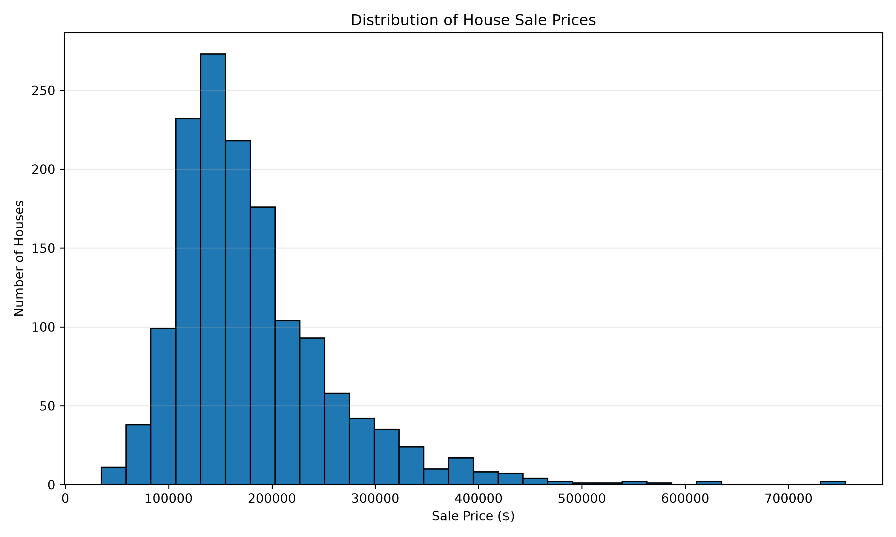
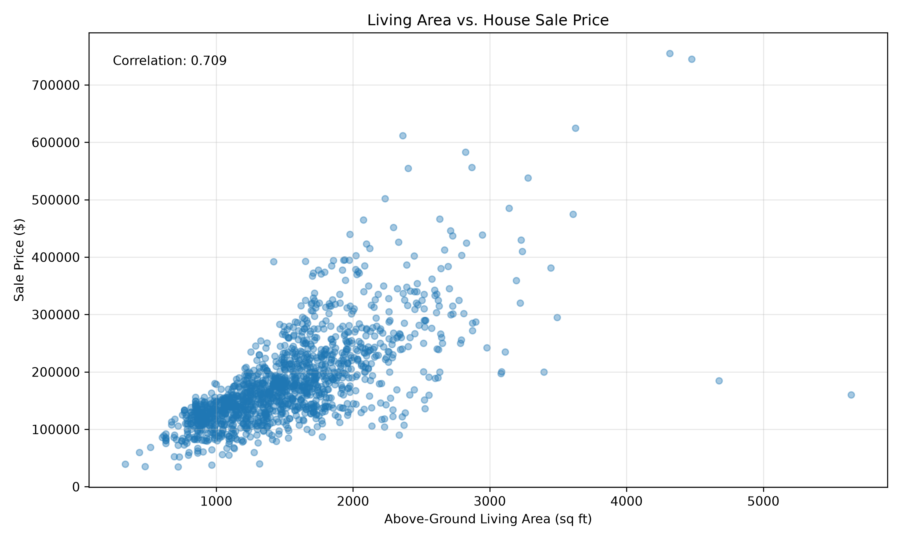

# Initial Data Exploration

## 1. Dataset Overview

The project uses the House Prices – Advanced Regression Techniques dataset from Kaggle. It contains historical housing information from Ames, Iowa.

The training dataset includes 1,460 houses and 81 columns. The target variable is `SalePrice`, which represents the final sale price of each house.

The dataset includes 43 categorical variables, 35 integer variables, and 3 floating-point variables.

## 2. Data Quality Check

An initial data quality check was performed using Python and Pandas.

The results showed:

- Total records: 1,460
- Total variables: 81
- Duplicate rows: 0
- Missing SalePrice values: 0

These results show that the target variable is complete and no duplicate rows were found.

## 3. Missing Values

Several variables contain missing values.

The variables with the largest numbers of missing values include:

| Variable | Missing Values |
|---|---:|
| PoolQC | 1,453 |
| MiscFeature | 1,406 |
| Alley | 1,369 |
| Fence | 1,179 |
| MasVnrType | 872 |
| FireplaceQu | 690 |
| LotFrontage | 259 |

Some missing values may indicate that a house does not have a particular feature, such as a pool or fence.

Other missing values will need to be examined before model training.

## 4. Sale Price Distribution

**Figure 1. Distribution of House Sale Prices**

The average house price is $180,921, while the median is $163,000. Most houses are priced in the lower to middle range, with 50% of sale prices between $129,975 and $214,000.

The distribution is right-skewed, with a skewness value of 1.88. This means that a smaller number of expensive houses increase the average price.

The results suggest that house prices vary considerably across the dataset. This is important when developing a prediction model because unusually expensive properties may be more difficult to predict accurately.

## 5. Living Area vs. SalePrice

**Figure 2. Relationship Between Living Area and Sale Price**

The correlation between above-ground living area (GrLivArea) and SalePrice is 0.7086, indicating a strong positive relationship. In general, houses with larger living areas tend to have higher sale prices.

However, some houses do not follow this pattern. For example, House ID 1299 has 5,642 square feet of living area but sold for only $160,000. House ID 524 also has a large living area of 4,676 square feet but sold for $184,750.

These observations suggest that house size alone cannot explain all differences in sale prices. Other features, such as overall quality, condition, and location, may also be important.

Unusual properties should be examined further because they may affect model performance.

## 6. Initial Findings

The data quality check suggests that the dataset is suitable for further exploration because there are no missing sale prices or duplicate rows.

However, missing values in other variables need to be handled carefully.

The next step is to examine the distribution of house prices and explore how property characteristics relate to sale prices.

## 7. Planned Data Preparation

Before training the models, the project will examine missing values and determine appropriate ways to handle them.

Numerical variables may require imputation, while categorical variables may need encoding before they can be used in regression models.

The dataset will also be divided into training and testing sets to evaluate prediction performance.

## 8. Next Steps

The next steps are to examine the distribution of SalePrice, identify unusual observations, explore important relationships between property characteristics and house prices, and develop a baseline regression model.

These results will help determine which machine learning methods are appropriate for the project.

## Data Source

Kaggle. House Prices – Advanced Regression Techniques.

https://www.kaggle.com/competitions/house-prices-advanced-regression-techniques/overview
