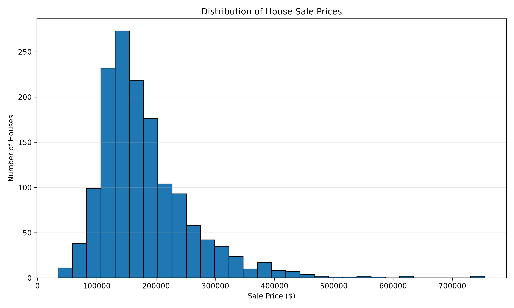
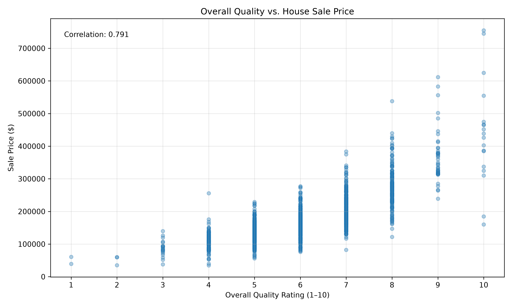
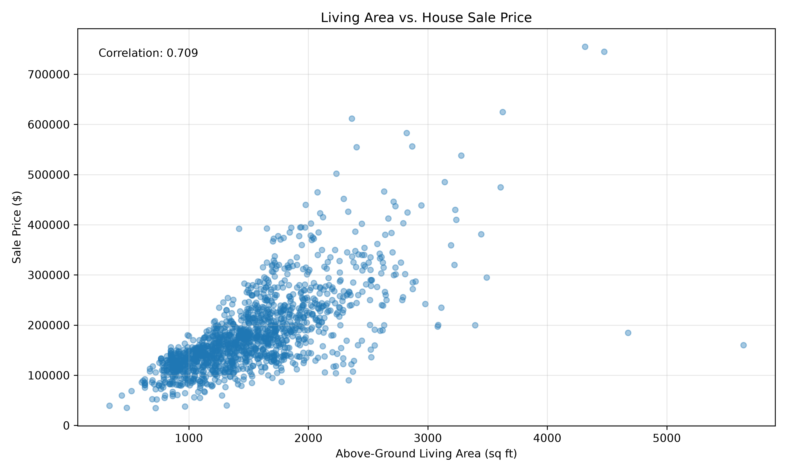
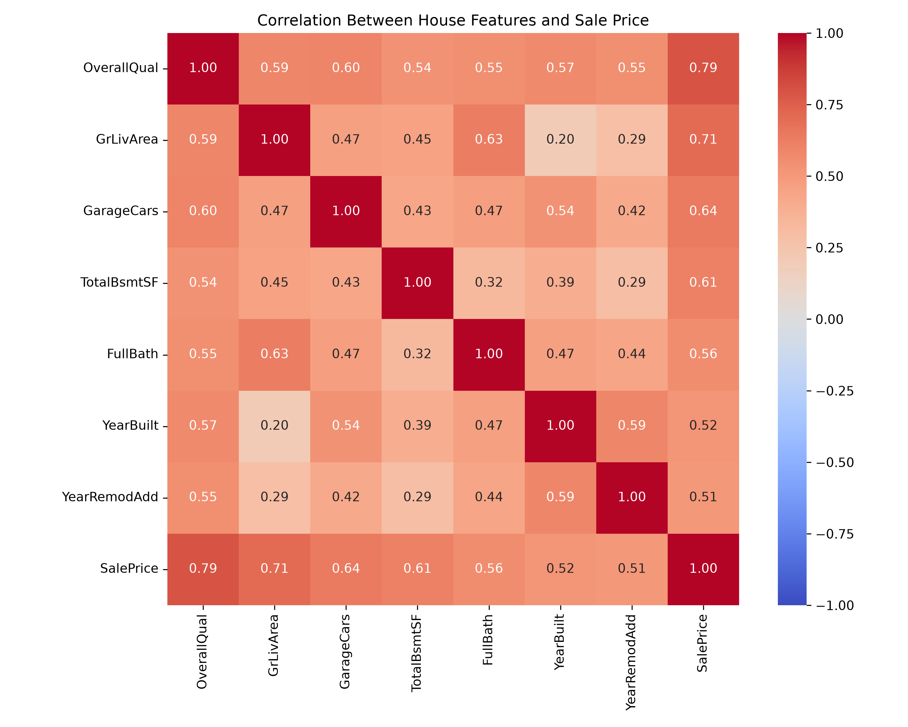
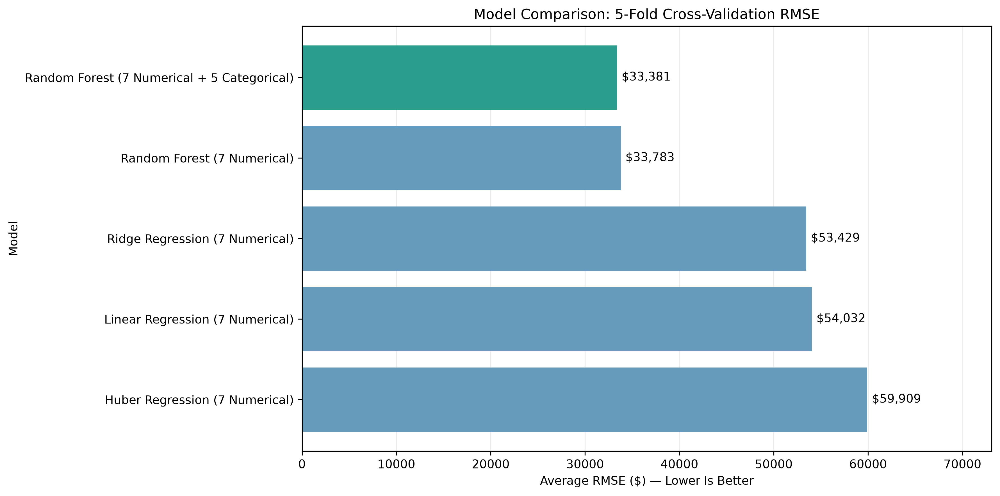
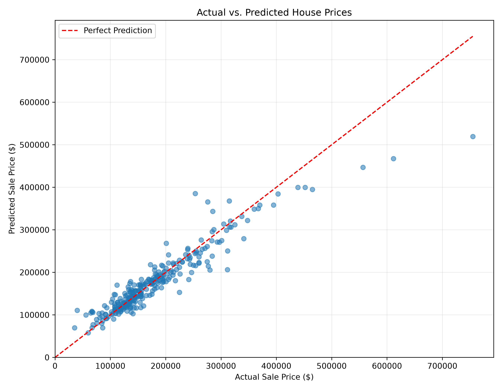
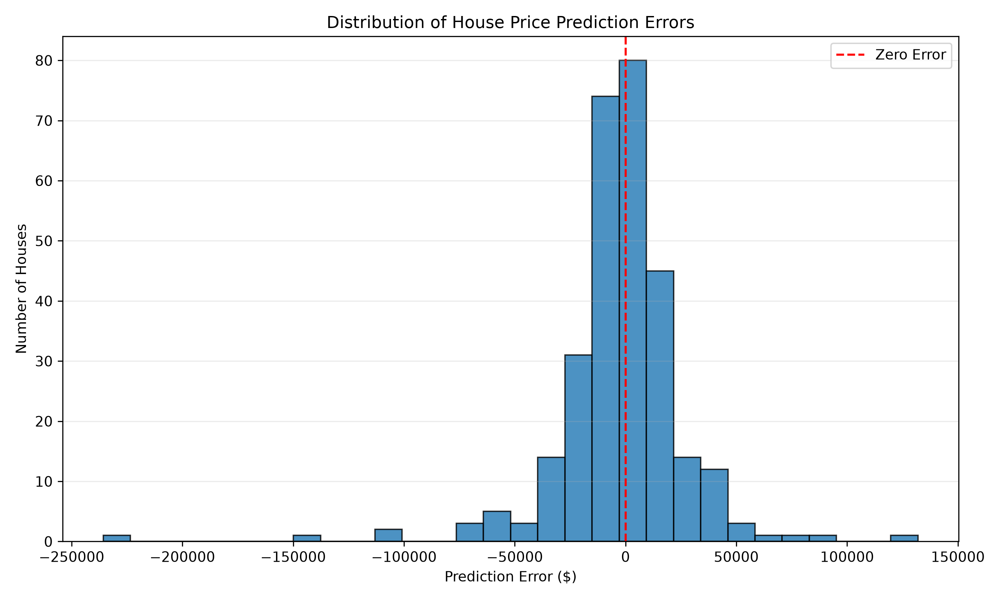
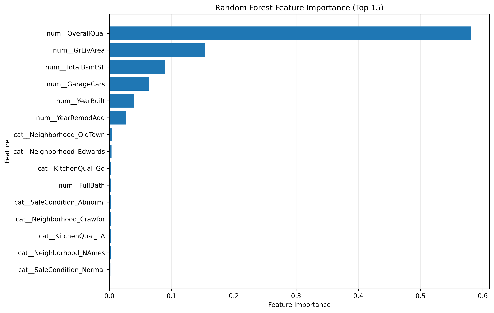

# House Price Prediction Using Machine Learning

**Course:** MSBA 265  
**Project:** Final Project  
**Dataset:** House Prices – Advanced Regression Techniques (Kaggle)

## Table of Contents

1. Executive Summary - 1
2. Business Problem and Stakeholders - 2
3. Dataset Description and Data Sources - 3
4. Exploratory Data Analysis (EDA) - 5
5. Data Preparation and Feature Selectio - 9
6. Modeling Approach - 11
7. Model Evaluation and Results - 13
8. Business Value and Recommendations - 19
9. Limitations and Future Improvements - 20
10. Conclusion - 22
11. References - 22
12. Appendix - 23

---
## 1. Executive Summary
When people want to sell a house, one of the hardest things is deciding how much to ask for it. There are many things to consider, like the size of the house, its condition, and where it is located. For this project, I wanted to see if I could use machine learning to predict house prices based on this information.

I used the House Prices dataset from Kaggle. It has information about 1,460 houses in Ames, Iowa. I first looked through the data to understand what was included and which features seemed to have a stronger relationship with house prices.

Next, I tried different models, including Linear Regression, Ridge Regression, Huber Regression, and Random Forest. After comparing their results, I found that Random Forest worked best for my project. I used 12 house features to build my final model.

I used 1,168 houses for training and 292 houses for testing. My final model had an RMSE of $29,971, an MAE of $18,112, and an R² of 0.8829. This means the model did a fairly good job of predicting house prices, but it still made some big mistakes on certain houses.

I think this project could be useful for people who are planning to sell a house or for real estate agents who need to suggest a listing price. They could use the predicted price as a starting point and compare it with other houses in the area. However, I would not rely on the model alone to decide the final price.

One thing to keep in mind is that the dataset only includes older house sales from Ames, Iowa. Because of that, I cannot say the model would work just as well in other cities or in today's housing market.

## 2. Business Problem and Stakeholders

### Business Problem

When someone wants to sell a house, they need to decide on a listing price. If the price is too high, it might take longer to find a buyer. If the price is too low, the seller might miss out on money.

The problem is that houses are different. Even houses in the same neighborhood can have different prices because of their size, age, quality, and other features.

For my project, I wanted to find out if I could use house information to predict a reasonable sale price.

**My business question is: Can machine learning help estimate house prices and give sellers a better starting point when deciding on a listing price?**

### Stakeholders

The main people who could use my project are home sellers and real estate agents.

Home sellers could use the prediction to get an idea of what their house might sell for.

Real estate agents could use it as another reference when talking with clients about pricing. They would still need to look at recent sales and the local housing market.

### Business Value

I think the biggest value of this project is helping people make a more informed pricing decision.

Instead of guessing a price based only on personal opinions, sellers and agents could compare the model's prediction with other information.

For example, if a seller wants to list a house for $300,000 but the model predicts $260,000, that difference could be a reason to look more closely at similar homes before choosing the asking price.

However, my project does not measure how much money sellers would actually save or earn by using the model. That would require testing it with real pricing decisions and newer housing data.

### How I Would Measure Success

I used RMSE, MAE, and R² to measure how well the model predicted sale prices.

My main goal was to reduce prediction errors when compared with simpler regression models.

For a future business application, I would also want to know whether the predictions help agents set better listing prices and whether the model works well with more recent housing data.

## 3. Dataset Description and Data Sources

### Data Source

For this project, I used the House Prices – Advanced Regression Techniques dataset from Kaggle (Kaggle, n.d.). The dataset contains housing information from Ames, Iowa. The Ames Housing dataset was also discussed by De Cock (2011).

Dataset link: https://www.kaggle.com/competitions/house-prices-advanced-regression-techniques/data

The dataset contains information about houses in Ames, Iowa. It includes details such as house size, neighborhood, overall quality, construction year, garage space, and sale price.

I used `train.csv` for my analysis because it includes the actual sale prices. The file has 1,460 houses and 81 columns, including the sale price.

Kaggle provides `test.csv`, which does not include actual sale prices. I used this file to check whether my saved model could make predictions on new records.

### Data Quality

Before building my models, I checked the dataset for missing values, duplicate records, and data types.

I did not find any duplicate rows, and there were no missing values in `SalePrice`, which is the variable I wanted to predict.

However, some other columns had missing values. For example, not every house had the same garage or basement information. I needed to handle missing values before training the model.

I noticed that a few houses had unusual combinations of size and sale price. These records were important to check because they could affect the model's predictions.

### Features Used

I did not use all the columns in my final model. Instead, I selected 12 features that describe different parts of a house.

The seven numerical features were OverallQual, GrLivArea, GarageCars, TotalBsmtSF, FullBath, YearBuilt, and YearRemodAdd.

The five categorical features were Neighborhood, KitchenQual, SaleCondition, HouseStyle, and ExterQual.

I used One-Hot Encoding for the categorical features so the Random Forest model could use them.

### Data Limitations

One limitation is that the dataset contains historical sales from Ames, Iowa. House prices can change over time, and the housing market in another city might be very different.

Because of this, I would need newer local data before using the model to support real pricing decisions in another market.

## 4. Exploratory Data Analysis (EDA)

Before building my models, I spent some time exploring the dataset. I wanted to understand what the house prices looked like, which features were related to price, and whether there were any unusual records.

### House Price Distribution

*Figure 1. Distribution of House Sale Prices. Source: Kaggle House Prices dataset; chart created using Python.*

The average sale price was about $180,921, while the median was $163,000. The lowest sale price was $34,900, and the highest was $755,000.

I noticed that most houses were in the lower and middle price ranges, but a smaller number of expensive houses made the distribution skewed to the right.

Because of this, I also tried using the log of SalePrice when training my models. This helped me work with a less skewed target variable.

### Features Related to House Prices

*Figure 2. Overall Quality vs. House Sale Price. Source: Kaggle House Prices dataset; chart created using Python.*

*Figure 3. Living Area vs. House Sale Price. Source: Kaggle House Prices dataset; chart created using Python.*

*Figure 4. Correlation Between House Features and Sale Price. Source: Kaggle House Prices dataset; chart created using Python.*

I checked the correlations between numerical features and SalePrice.

OverallQual had the strongest correlation with SalePrice at 0.791. GrLivArea, which measures above-ground living space, had a correlation of 0.709.

GarageCars and TotalBsmtSF also showed fairly strong relationships with sale price, with correlations of 0.640 and 0.614.

From this, I could see that house quality, living space, and some garage and basement features were useful starting points for my models.

However, correlation does not mean that a feature directly causes the price to increase or decrease.

### Unusual Houses

I found a few houses that looked unusual.

For example, House ID 1299 had 5,642 square feet of above-ground living space and an OverallQual score of 10, but its recorded sale price was only $160,000.

This was unusual compared with other large, high-quality houses in the dataset.

When I checked this house during cross-validation, it caused a very large prediction error for one of my linear models.

I kept the record in my analysis instead of deleting it just to improve the model results. It helped me understand why I needed to compare different models and pay attention to unusual observations.

### What I Learned from EDA

After exploring the data, I decided to focus on a smaller group of house features instead of using every column.

I learned that looking at average model performance is not enough. Some houses can be much harder to predict than others, so I needed to check individual prediction errors as well.

## 5. Data Preparation and Feature Selection

### Preparing the Data

After exploring the dataset, I started preparing the data for modeling.

I used `SalePrice` as the target variable because my goal was to predict how much a house would sell for.

I first separated the dataset into training and testing groups. I used 80% of the data for training and kept the other 20% for testing. This gave me 1,168 training records and 292 testing records.

I used a random seed of 42 so I could get the same split when running the code again.

### Choosing the Features

I decided to use 12 house features for my final Random Forest model.

Seven of them were numerical features: OverallQual, GrLivArea, GarageCars, TotalBsmtSF, FullBath, YearBuilt, and YearRemodAdd.

The other five were categorical features: Neighborhood, KitchenQual, SaleCondition, HouseStyle, and ExterQual.

I chose these features because they describe different parts of a house, including its size, quality, location, age, and condition.

### Handling Missing Values and Categorical Data

Some of the selected features had missing values, so I used a preprocessing pipeline to handle them.

For the numerical features, I used median imputation. For the categorical features, I used the most common value when information was missing.

I used One-Hot Encoding to turn categorical information into numerical columns that the model could work with.

I used a scikit-learn Pipeline so the preprocessing steps and model could work together.

### Avoiding Data Leakage

One thing I needed to be careful about was data leakage. I did not want information from the testing data to affect how the model was trained.

To avoid this, I fitted the preprocessing steps using training data rather than the full dataset.

I used 5-fold cross-validation on the training data to compare models before evaluating the saved model on the separate test set.

### Target Transformation

House prices were not evenly distributed, so I trained my later models using `log1p(SalePrice)`.

After making predictions, I used `expm1()` to convert the results back into dollar amounts.

This allowed me to compare prediction errors in dollars, which is easier to understand when discussing house prices.

### Final Prepared Data

My final model used 12 original house features. After One-Hot Encoding, these were expanded into 54 numerical input columns based on the training data.

I saved the preprocessing steps and Random Forest model together so I could reload them without rebuilding the preprocessing manually.

## 6. Modeling Approach

### Models I Tested

For this project, I did not want to choose a model without comparing it with other options. I started with simpler regression models and then tried Random Forest to see if it could make better predictions. I used Python and scikit-learn to train and compare the models (Pedregosa et al., 2011).

I tested four types of models:

- **Linear Regression:** I started with this model because it was a simple way to see how house features were related to sale prices.
- **Ridge Regression:** I wanted to see if adding regularization could help the model handle relationships between the features.
- **Huber Regression:** I tried this model because I noticed some unusual houses in the dataset, and I wanted to see if it handled large errors better.
- **Random Forest:** I wanted to test a model that could learn more complicated relationships between house features and prices.

### How I Compared the Models

I used 5-fold cross-validation on my training data.

This means I divided the training data into five groups. Each time, I trained the model using four groups and evaluated it using the remaining group. I repeated this process until every group had been used for validation.

I compared the results using three metrics:

- **RMSE:** Shows how large prediction errors are, with more weight given to bigger mistakes.
- **MAE:** Shows the average absolute difference between predicted and actual house prices.
- **R²:** Shows how much of the variation in house prices the model explains.

I converted the predictions back into dollars before calculating the performance metrics so the results would be easier to understand.

### Improving the Random Forest Model

At first, I tested Random Forest using seven numerical features.

Later, I added five categorical features, including Neighborhood and KitchenQual, to see if the model could make better predictions with more information.

The Random Forest model with 12 features had the lowest average RMSE in my cross-validation comparison.

Its average RMSE was $33,381.19, compared with $33,783.10 for Random Forest using only seven features.

The improvement was not very large, but the 12-feature model performed slightly better, so I chose it for my final model.

### Final Model

My final model was a Random Forest Regressor with 200 trees, a maximum depth of 12, and a minimum leaf size of 2.

I used `random_state=42` to make the results reproducible.

I saved the preprocessing steps and the trained model together in a joblib file.

After saving it, I reloaded the model and checked that it could make predictions without retraining.

I cloned my GitHub project into a separate folder and tested it in a new Python environment. The saved model produced the same predictions and evaluation results.

## 7. Model Evaluation and Results

### Model Comparison

*Figure 5. Model Comparison Using 5-Fold Cross-Validation RMSE. Source: Kaggle House Prices dataset; chart created using Python.*

After training the models, I compared their performance using 5-fold cross-validation. I wanted to see which model made smaller prediction errors and whether the results were consistent across different groups of houses.

Here are my results:

| Model | Features | Average RMSE | Average MAE | Average R² |
|---|---|---:|---:|---:|
| Linear Regression | 7 numerical | $54,031.99 | $22,258.18 | 0.3201 |
| Huber Regression | 7 numerical | $59,908.65 | $21,863.14 | 0.0605 |
| Ridge Regression | 7 numerical | $53,429.25 | $22,211.07 | 0.3439 |
| Random Forest | 7 numerical | $33,783.10 | $20,911.80 | 0.8055 |
| Random Forest | 12 features | $33,381.19 | $20,196.80 | 0.8103 |

Random Forest performed better than the other models in my comparison. The version with 12 features had the lowest average RMSE and MAE.

I also noticed that the simpler regression models had much larger differences between their cross-validation results. Some unusual houses caused very large prediction errors.

The 12-feature Random Forest had an average RMSE of $33,381.19, with a standard deviation of $4,759.61 across the five folds. This was more consistent than the regression models I tested.

### Final Test Results

*Figure 6. Actual vs. Predicted House Prices. Source: Kaggle House Prices dataset; chart created using Python.*

After comparing the models, I trained my final Random Forest model on 1,168 houses and evaluated it using the 292-house test set.

The results were:

| Metric | Result |
|---|---:|
| RMSE | $29,971.00 |
| MAE | $18,112.09 |
| R² | 0.8829 |

The MAE of about $18,112 means the model's predictions were off by around $18,112 on average in absolute dollar terms.

The R² of 0.8829 means the model explained about 88.3% of the variation in sale prices in this test set.

I was happy with these results, but the model was not accurate for every house. Some houses still had large prediction errors.

### Looking at Individual Predictions

*Figure 7. Distribution of House Price Prediction Errors. Source: Kaggle House Prices dataset; chart created using Python.*

I checked the actual and predicted prices for individual houses.

For example, House ID 893 had an actual sale price of $154,500, and the model predicted $143,142.40. The difference was $11,357.60.

However, House ID 219 had an actual sale price of $311,500, but the model predicted $206,143.70. That was an error of more than $105,000.

This showed me that even when the overall model results look good, some individual predictions can still be far from the actual price.

### Checking Unusual Records

During my earlier analysis, I found that House ID 1299 had an unusual combination of a large living area, high quality rating, and relatively low sale price.

It caused a very large error in one cross-validation fold when I used a linear model.

I checked what happened when I excluded that house from the fold's evaluation. The RMSE dropped from $129,040.84 to $23,535.10.

I used this as a sensitivity check, not as a reason to remove the house from the final dataset. It helped me understand how much one unusual record could affect the results.

### Reproducibility Check

I saved my final model and preprocessing pipeline in a joblib file.

I then cloned my GitHub repository into a new folder, created a new Python environment, and installed the packages using `requirements.txt`.

After reloading the saved model, I ran the evaluation script again and got the same results: RMSE $29,971.00, MAE $18,112.09, and R² 0.8829.

This confirmed that I could reproduce the saved model's results using the project files.

One limitation is that I had already looked at the test-set performance during development, so I would want a completely new dataset for another independent check before using the model in a real business setting.

### Random Forest Feature Importance

*Figure 8. Random Forest Feature Importance. Source: Kaggle House Prices dataset; chart created using Python.*

I checked which features were most important in my final Random Forest model.

OverallQual had the highest importance, followed by GrLivArea and TotalBsmtSF. This tells me that the model relied heavily on house quality, living space, and basement size when making predictions.

I noticed that some neighborhood and other categorical features appeared in the results after One-Hot Encoding.

However, feature importance does not mean that these features directly cause house prices to change.

## 8. Business Value and Recommendations

### How This Model Could Be Used

For me, the main purpose of this project is not just to predict a number. I wanted to see how the prediction could help someone make a decision.

For example, a real estate agent could enter information about a house, such as its size, quality, neighborhood, and age. The model could then give an estimated sale price.

The agent could compare that estimate with recent sales of similar houses before discussing a listing price with the seller.

I think this would be more useful than treating the prediction as the final answer.

### Business Value

The biggest potential value is giving sellers and real estate agents another way to check their pricing decisions.

For example, suppose a seller wants to list a house for $300,000, but the model predicts $260,000. The agent could use that difference as a reason to review similar properties and explain why the asking price might need another look.

The model could also help agents make an initial price estimate before doing a more detailed market review.

However, I have not tested whether using this model actually helps houses sell faster or increases the money sellers receive. Those would be important questions to test before using it in a real business.

### My Recommendations

Based on my results, I would recommend using the model as a starting point rather than relying on it to set a final listing price.

I would also recommend checking recent local sales, the condition of the property, and anything unusual about the house.

If the model's prediction is very different from the seller's expected price, I would take that as a reason to investigate further instead of assuming the model is correct.

### How I Would Check Its Business Value

If I had the opportunity to test this project with a real estate agency, I would compare pricing decisions made with and without the model.

I would want to look at things like the difference between listing price and final sale price, how long the house stayed on the market, and whether agents found the predictions useful.

This would help me understand whether the model actually improves pricing decisions, instead of only showing good prediction scores.

### FastAPI Prediction Application

A FastAPI application was added to demonstrate how the saved Random Forest model can be used to predict house prices.

The API accepts 12 house features and returns a predicted sale price in US dollars.

For example, a sample house with 1,800 square feet, an overall quality rating of 7, and a two-car garage received a predicted price of $220,642.90.

The API prediction was compared with a prediction made directly in Python. Both returned the same result.

Three automated tests also passed, covering the health check, house price prediction, and invalid input handling.

The application demonstrates a possible way to use the model. It has not been tested with real estate agents or evaluated using new real-world sales data.

## 9. Limitations and Future Improvements

### Limitations

Even though my Random Forest model performed well on the test data, there are still some limitations.

The first limitation is the dataset. I used historical housing data from Ames, Iowa. Since house prices change over time and different cities have different housing markets, I cannot assume my model would work equally well in California or other areas.

Another limitation is that the model does not predict every house accurately. For example, I found some houses with unusual prices compared with their size and quality. These houses were harder for the models to predict.

I only used 12 features in my final model. There are other things that could affect house prices, such as recent market changes, renovations, and nearby property sales. My model does not include all of that information.

One more limitation is that I had already checked the test results during model development. Because of this, I would want to test the model on a completely new dataset before saying it is ready for real-world use.

Finally, I have not tested the model with real sellers or real estate agents. I know how well it predicts prices on this dataset, but I do not know yet whether it would improve actual pricing decisions.

### Future Improvements

If I continue working on this project, the first thing I would do is find more recent housing data. I would also like to test the model using homes from a different city to see how well it performs outside Ames.

I would also try adding more useful features, such as recent sales of similar houses and local market conditions.

Another improvement would be to look more closely at houses with large prediction errors. I want to understand what makes those houses different and whether I can improve the predictions without simply removing difficult records.

I would also like to build a simple tool where someone could enter house information and receive a predicted price. This could make the project easier for someone without programming experience to use.

Lastly, I would want to test the model with real estate agents and compare their pricing decisions with and without the model. That would help me understand whether the project has real business value.

## 10. Conclusion

For this project, I wanted to see if machine learning could help predict house prices using information about the property.

I started by exploring the Kaggle housing dataset and looking at how different house features were related to sale prices. After that, I prepared the data and compared several models, including Linear Regression, Ridge Regression, Huber Regression, and Random Forest.

Based on my cross-validation results, Random Forest with 12 features worked best for my project. On the 292-house test set, the final model had an RMSE of $29,971, an MAE of $18,112, and an R² of 0.8829.

One thing I learned was that getting a good overall score does not mean every prediction will be accurate. Some unusual houses had much larger errors, so I think it is important to look at individual predictions instead of only focusing on the average results.

I learned how important it is to organize a machine learning project properly. I saved my model, tested it in a new Python environment, and was able to reproduce the same results.

I think the model could be useful as an additional reference for home sellers and real estate agents when discussing house prices. However, I would not use it by itself to decide a listing price, especially because the data comes from historical sales in Ames, Iowa.

Overall, this project helped me understand the full process of building a machine learning model, from preparing the data to evaluating the results and thinking about how the predictions could be used in a business setting.

## References

De Cock, D. (2011). Ames, Iowa: Alternative to the Boston housing data as an end of semester regression project. *Journal of Statistics Education, 19*(3). https://doi.org/10.1080/10691898.2011.11889627

Kaggle. (n.d.). *House prices – Advanced regression techniques* [Data set]. https://www.kaggle.com/competitions/house-prices-advanced-regression-techniques/data

Pedregosa, F., Varoquaux, G., Gramfort, A., Michel, V., Thirion, B., Grisel, O., Blondel, M., Prettenhofer, P., Weiss, R., Dubourg, V., Vanderplas, J., Passos, A., Cournapeau, D., Brucher, M., Perrot, M., & Duchesnay, É. (2011). Scikit-learn: Machine learning in Python. *Journal of Machine Learning Research, 12*, 2825–2830. https://jmlr.org/papers/v12/pedregosa11a.html

## Appendix

### Appendix A. GitHub Repository

I saved my project files on GitHub, including the Python scripts, dataset information, model files, and results.

GitHub repository: https://github.com/Wendy-Chen56/house_prices_final_project

The repository is currently private, so anyone reviewing the project will need access.

### Appendix B. Final Model Settings

My final model uses Random Forest Regression with the following settings:

| Setting | Value |
|---|---|
| Model | Random Forest Regressor |
| Number of trees | 200 |
| Maximum depth | 12 |
| Minimum samples per leaf | 2 |
| Random state | 42 |
| Original input features | 12 |
| Training records | 1,168 |
| Testing records | 292 |
| Cross-validation | 5 folds |

I used a preprocessing pipeline to handle missing values and categorical features. The model was trained using the log of SalePrice, and I converted predictions back to dollars.

### Appendix C. Saved Model and Results

I saved the final model and preprocessing pipeline together in:

`artifacts/house_price_model.joblib`

The final test predictions are saved in:

`results/test_predictions.csv`

The model comparison results are saved in:

`results/model_comparison.csv`

### Appendix D. Reproducibility Test

To check my project, I cloned the GitHub repository into a separate folder and created a new Python environment.

I installed the required packages using `requirements.txt`, loaded the saved model, and ran the evaluation script again.

I got the same results as my original project:

- RMSE: $29,971.00
- MAE: $18,112.09
- R²: 0.8829

I recorded the steps and results in `docs/reproducibility_test.md`.

This was my own reproducibility check. An independent peer verification is still needed for the course requirements.

### Appendix E. Data-to-Action Pipeline

I created a pipeline diagram to show how the project connects the Kaggle data, preprocessing, model training, predictions, and possible pricing decisions.

The diagram is saved in:

`docs/data_to_action_pipeline.pdf`

The written explanation is saved in:

`docs/data_to_action_pipeline.md`

The pricing decision and feedback stages are planned uses of the model, not parts that have already been tested with real estate agents.
